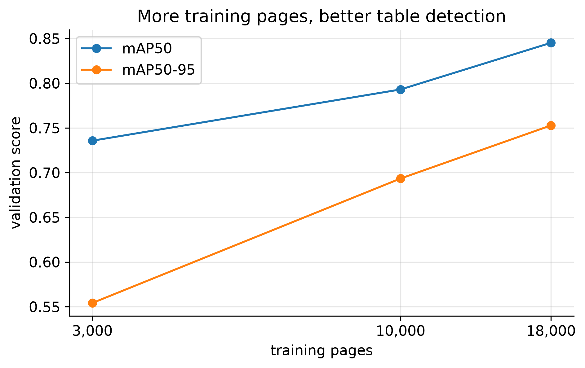
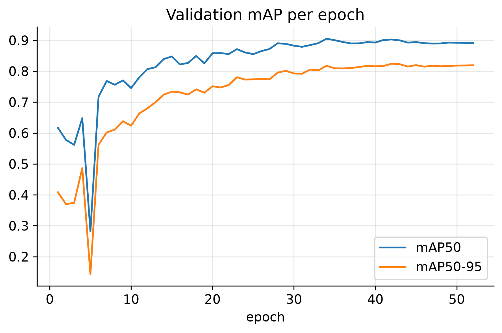
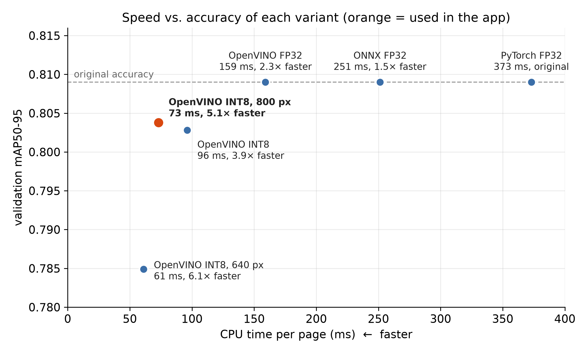
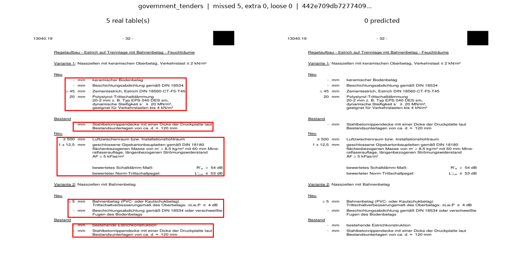
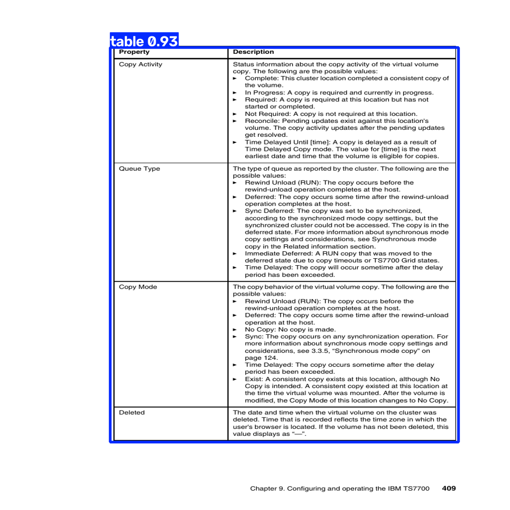

# Table Detection in Document Pages — Technical Details

> პროექტის დოკუმენტაცია ინგლისურად დავწერე, რადგან კოდი და ტექნიკური ტერმინები
> ინგლისურადაა. საჭიროების შემთხვევაში ქართულ ვერსიასაც მოგაწვდით.

**Task:** find every table on a document page image and draw a box around it
(one-class object detection).
**Final model:** YOLO11n fine-tuned on 18,000 DocLayNet pages, 1024 px, SGD,
up to 60 epochs. Deployed as an OpenVINO INT8 model at 800 px.

---

## 1. Selecting the data

### 1.1 Dataset

**DocLayNet v1.2** (`docling-project/DocLayNet-v1.2` on Hugging Face), pinned to
revision `85cadd47c3ac59e1a2c3677ec72a02b143d96430` so the data can never change
under us.

- About 80,000 human-annotated pages of real documents, 1025 × 1025 px each.
- 11 layout classes (text, title, picture, table, …). We keep only **Table**
  (`category_id = 9`) and turn the task into one-class detection.
- 6 document types ("domains"): financial reports, scientific articles, patents,
  laws and regulations, government tenders, manuals.
- Comes with an official train / validation / test split **by document**, so no
  document appears in two splits.

**Why this dataset:** my earlier research paper on OCR was based on document
analysis, and I wanted to build something similar with a YOLO model: instead of
reading the text, first find *where* the structured content (the tables) sits
on a page. DocLayNet fits this well:

- real documents with varied layouts, not synthetic pages;
- human-made annotations;
- an official split by document, so test pages come from unseen documents;
- an open licence;
- a practical use: finding tables is the first step of extracting them from
  PDFs and scans, before OCR or a table parser turns them into data.

My paper: *From an Untranscribed Manuscript to Model-Assisted Transcription: A
Synthetic-to-Real Pipeline for Georgian Nuskhuri Manuscripts.*

### 1.2 Choosing the pages

We use a subset, not all 69k training pages, to fit free compute. The selection
has three steps (same code for every split):

1. **Shuffle** with a fixed seed (42).
2. **At most 10 pages per document.** Without this cap, one 300-page report
   would dominate and the model would memorise its layout.
3. **Stratify** by *(document type, has a table / has no table)*. Each of the
   12 groups gets a share of the pages in proportion to its size (at least one
   page each; leftover places go to the largest rounding remainders).

The training pool is shuffled once more. The 3k / 10k / 18k training sets are
**nested prefixes** of this one list: the 3,000 pages are the first 3,000 of the
10,000, which are the first 10,000 of the 18,000.

| Split | Pages | Documents | Pages with a table | Tables |
|---|---|---|---|---|
| Train | 18,000 | 2,579 | 21.3% | 5,901 |
| Validation | 500 | 127 | 23.6% | 180 |
| Test | 500 | 139 | 23.2% | 200 |

Training pages by document type: scientific articles 6,504 · financial reports
4,016 · patents 2,908 · laws and regulations 2,090 · government tenders 1,438 ·
manuals 1,044.

**Why keep pages without tables (~78%)?** The model must also learn what a
table-free page looks like, otherwise it draws boxes on every text block.

### 1.3 Download, labels and checks

The dataset is tens of GB of Parquet files, so instead of downloading it, the
notebooks stream it from Hugging Face in two passes: first only two small
columns, to choose the pages, then the images of the chosen pages only. Table
boxes are converted to YOLO format (clipped to the page; pages without a table
get an empty label file). Two checks run every time: **no document is shared
between splits**, and the chosen pages match the saved `selected_pages.json`, so
every machine trains and scores on exactly the same pages.

---

## 2. Choosing the model

**YOLO11n** (Ultralytics 8.3.221), pretrained on COCO, fine-tuned for tables.

**Why YOLO11n:**

- **Small and fast:** 2.6 M parameters, so it trains on a free GPU (the final
  model in 6.3 h) and runs on a CPU, which matters for the optimisation and the
  demo.
- **Pretrained:** starting from COCO weights (transfer learning) needs far less
  data and time than training from scratch.
- **Tables are large, clear objects,** so a small model is enough. The errors in
  section 7 come from unclear table boundaries and too few examples of some
  table types, not from the model being too small.
- **One library for everything:** training, evaluation, and export to ONNX,
  OpenVINO and INT8.

**Alternatives:** larger YOLO models (YOLO11s/m), two-stage detectors such as
Faster R-CNN, and transformer detectors such as RT-DETR or Microsoft's Table
Transformer. They might be more accurate, but they are slower to train on free
GPUs and slower on a CPU. They also have many more parameters, so with 18,000
training pages they carry a higher risk of overfitting, especially
transformers, which need more data and longer training. The scaling study
(section 4) shows that even YOLO11n was still limited by data, so more pages
would help more than a bigger model. Comparing YOLO11s and RT-DETR is listed as
future work.

---

## 3. Training setup and metrics

### 3.1 Training

- **Augmentation:** Ultralytics defaults, except **mosaic, horizontal flip and
  vertical flip turned off**. Mosaic stitches four images into one, and flips
  mirror pages. Real documents never look like that, and mirrored text and
  tables would teach the model wrong patterns.
- **Model selection:** after every epoch the model is scored on the validation
  set; `best.pt` is the epoch with the highest **mAP50-95**. Training stops early
  if it has not improved for `patience` epochs.

### 3.2 Metrics

- **mAP50:** a box counts as correct if it overlaps the real table by at least
  50% (IoU ≥ 0.5): "did it find the table?". **mAP50-95** averages over stricter
  overlaps up to 95%: "how tightly does the box fit?". This is the main metric.
- **Precision and recall** are reported at the confidence threshold with the
  best F1, which differs between models, so they often move in opposite
  directions. **Models are compared on mAP**, which does not depend on a
  threshold.
- All scores use the same settings (500 validation pages, `conf=0.001`,
  `rect=False`, batch 4). With only 180 validation tables, differences of about
  ±0.01 are noise.

---

## 4. Experiment 1: how much training data do we need?

**Question:** how does detection quality grow with the number of training pages?

**Setup:** three runs on 3,000, 10,000 and 18,000 pages. Everything else fixed:
YOLO11n, 640 px, 20 epochs, patience 5, batch 8, seed 42, the same 500
validation pages. Nested training sets (see 1.2), so a bigger set only adds pages.

Trained on a free Kaggle GPU:

| Training pages | mAP50 | mAP50-95 | Precision | Recall | Best epoch | Training time |
|---|---|---|---|---|---|---|
| 3,000 | 0.736 | 0.554 | 0.833 | 0.683 | 19 / 20 | 0.27 h |
| 10,000 | 0.793 | 0.693 | 0.834 | 0.767 | 19 / 20 | 0.83 h |
| 18,000 | 0.845 | 0.753 | 0.890 | 0.767 | 20 / 20 | 1.47 h |



**Findings:**

- 3k → 10k: **+0.139 mAP50-95** (for 7,000 more pages). 10k → 18k: **+0.059**
  (for 8,000 more pages). Diminishing returns: each extra page helps less.
- The gain is larger for mAP50-95 than for mAP50: more data mostly improves
  **how tightly boxes fit**, not only whether a table is found.
- The best epoch was the **last or second to last** in every run, so all three
  models were still improving. 20 epochs at 640 px was not enough, which
  motivated Experiment 2.

**Run-to-run variation.** The same study was first run on a rented GPU, on the
**exact same pages** (checked page by page). Scores differed by up to 0.02
mAP50-95 (10k: 0.716 vs 0.693; 18k: 0.748 vs 0.753), from GPU-level randomness
in training. So differences smaller than about 0.02 between single runs should
not be over-interpreted; the overall trend was the same in both runs.

---

## 5. Experiment 2: higher resolution and longer training

**Question:** the 18k model had not finished learning. Do more epochs and a
larger input size help?

**Why resolution could matter:** DocLayNet pages are 1025 px. At 640 px a page
keeps only ~40% of its pixels, which blurs thin table borders and lines.

| Run | Image size | Epochs (best) | Optimizer | mAP50 | mAP50-95 | Precision | Recall |
|---|---|---|---|---|---|---|---|
| Scaling study, 18k (Kaggle) | 640 | 20 (20) | AdamW, lr 0.002 | 0.845 | 0.753 | 0.890 | 0.767 |
| Kaggle | 896 | 30 (30) | AdamW, lr 0.002 | 0.852 | 0.756 | 0.857 | 0.802 |
| Rented GPU | 1024 | 60 (56) | SGD, lr 0.01 | 0.884 | 0.809 | 0.934 | 0.806 |
| Kaggle (T4) | 1024 | 60, stopped at 52 (42) | SGD, lr 0.01 | 0.894 | 0.809 | 0.920 | 0.835 |

All runs: 18,000 training pages, same validation pages, batch 8, seed 42.

### 5.1 896 px, 30 epochs: almost no gain

F1 went from 0.824 to 0.829 and mAP50-95 from 0.753 to 0.756, well within
run-to-run noise. Precision fell and recall rose: that is a different point on
the same precision/recall trade-off, not a better model. At the last epoch,
training and validation losses were still falling and the best epoch was the
last one: the model was **undertrained**, not overfitting.

### 5.2 The hidden variable: the optimizer

The 1024 px / 60-epoch run was clearly better (mAP50-95 0.809, with both
precision and recall higher). Reading the training logs showed why the
comparison was not fair: with `optimizer="auto"`, Ultralytics **chooses the
optimizer from the length of the run**:

```
iterations = ceil(pages / max(batch, 64)) × epochs
iterations > 10,000  →  SGD,   lr 0.01,  momentum 0.9
otherwise            →  AdamW, lr 0.002, momentum 0.9   (lr = 0.002·5/(4 + classes))
```

- 18,000 pages × 20 or 30 epochs → 5,640 / 8,460 iterations → **AdamW**
- 18,000 pages × 60 epochs → 16,920 iterations → **SGD**

So the 1024 px run changed **three things at once**: resolution, epochs and
optimizer. To make this visible, the final notebook sets
`optimizer="SGD", lr0=0.01, momentum=0.9` explicitly instead of relying on "auto".

A run at 896 px / 30 epochs with SGD would separate the optimizer effect from
the epochs effect. It did not fit into the time available, so it is listed under
future work (section 11).

### 5.3 Reproducing on free compute

The 1024 px run was first trained on a rented GPU (RTX 4090, ~4.3 min/epoch),
then **re-run on a free Kaggle T4** (~7 min/epoch, 6.3 h). Early stopping ended
it at epoch 52 (best epoch 42). Validation mAP50-95 was the same (0.809 vs 0.809)
and mAP50 slightly higher (0.894 vs 0.884): the result reproduces. The Kaggle
model is the final one, because the whole project can then be rerun from the
notebooks on free hardware. (A second Kaggle run gave exactly the same scores.)



### 5.4 Final test score

The final model was scored **once** on the 500 test pages (139 documents, 200
tables), with the same settings as validation. All choices above were made on
the validation set; the test pages were never used to pick a model or a setting.

| | mAP50 | mAP50-95 | Precision | Recall |
|---|---|---|---|---|
| Validation (500 pages, 180 tables) | 0.894 | 0.809 | 0.920 | 0.835 |
| **Test (500 pages, 200 tables)** | **0.927** | **0.869** | **0.950** | **0.860** |

Test is 0.06 higher than validation because its pages are easier: fewer
government-tender tables, the hardest type (11% of test tables against 16%), and
more from laws and regulations, which the model never missed. The test split was
used once before, to score the earlier rented-GPU model (mAP50-95 0.863), but
never to choose between models.

---

## 6. Experiment 3: optimisation (no retraining)

**Question:** how much smaller and faster can the trained model get, and what
does it cost in accuracy?

**Setup:** start from the trained 1024 px model and change only **how it is
stored and run**. Every variant is scored on the same 500 validation pages and
timed on **CPU** (Intel i7-12700H), one page at a time, median over 50 pages
after 5 warm-up pages. The time covers everything an app would do: resize,
network, NMS.

| Variant | Size | ms per page | Speed-up | mAP50 | mAP50-95 |
|---|---|---|---|---|---|
| PyTorch FP32 (before) | 5.6 MB* | 373 | 1.0× | 0.894 | 0.809 |
| ONNX FP32 | 10.9 MB | 251 | 1.5× | 0.894 | 0.809 |
| OpenVINO FP32 | 10.9 MB | 159 | 2.3× | 0.894 | 0.809 |
| OpenVINO INT8 | 3.5 MB | 96 | 3.9× | 0.894 | 0.803 |
| **OpenVINO INT8, 800 px** | **3.4 MB** | **73** | **5.1×** | **0.893** | **0.804** |
| OpenVINO INT8, 640 px | 3.4 MB | 61 | 6.1× | 0.867 | 0.785 |

\* Ultralytics stores `.pt` weights as 16-bit floats to save disk space and
converts them back to 32-bit when loading. True FP32 storage is ~10.5 MB
(2.6 M weights × 4 bytes), so compare INT8 against the 10.9 MB rows: about 3×
smaller.



### 6.1 What each technique does

- **ONNX:** saves the network as a fixed graph that a runtime can optimise ahead
  of time. Same weights, same results, less overhead.
- **OpenVINO:** Intel's runtime compiles that graph for the specific CPU (its
  vector instructions, fastest layer versions). Still the same weights.
- **INT8 quantization:** stores weights and activations as 8-bit integers
  instead of 32-bit floats: 4× less memory per value and faster integer maths.
  It needs no retraining; a few hundred pages are run through the model to
  measure each layer's value range (*calibration*). The calibration used the
  validation pages (Ultralytics' default); it never sees labels, so the effect on
  the scores should be small.
- **Smaller input:** 800 px has 61% of the pixels of 1024 px, so less work, but
  thin table lines blur at low resolution.

### 6.2 Findings

- **Changing the format is free:** ONNX and OpenVINO give exactly the same mAP as
  PyTorch, because the weights are identical. OpenVINO alone is 2.3× faster.
- **INT8 is the biggest win:** 3× smaller than FP32 and 1.7× faster than OpenVINO
  FP32, for −0.006 mAP50-95.
- **800 px is the sweet spot:** same accuracy as INT8 at 1024 px (0.804 vs 0.803,
  noise), 5.1× faster than the original. At 640 px, mAP50-95 drops by 0.024,
  which agrees with Experiment 2: tables need resolution.
- **Chosen for deployment: OpenVINO INT8 at 800 px** — 3.4 MB, ~73 ms per page
  on a laptop CPU, mAP50-95 0.804 (−0.005 against the original).

---

## 7. Error analysis: where does the final model fail?

**Setup** (`notebooks/04_failure_analysis.ipynb`): the final model on the 500
validation pages, at confidence 0.25 (the app's default). A prediction counts as
finding a table when IoU ≥ 0.5. Every mistake is one of three kinds:

- **Missed:** a real table with no matching prediction.
- **Extra:** a predicted box that matches no real table.
- **Loose:** the table was found, but the box fits badly (IoU below 0.75).

| Real tables | Found | Missed | Extra boxes | Loose boxes | Pages with no mistake |
|---|---|---|---|---|---|
| 180 | 153 (85%) | 27 | 23 (on 19 pages) | 8 | 466 of 500 |

| Document type | Pages | Real tables | Missed | Extra | Loose | Missed % |
|---|---|---|---|---|---|---|
| Financial reports | 114 | 87 | 11 | 14 | 5 | 13% |
| Government tenders | 47 | 29 | 11 | 4 | 1 | **38%** |
| Patents | 93 | 40 | 5 | 3 | 1 | 12% |
| Laws and regulations | 45 | 7 | 0 | 1 | 0 | 0% |
| Manuals | 9 | 2 | 0 | 1 | 1 | 0% |
| Scientific articles | 192 | 15 | 0 | 0 | 0 | 0% |

Financial reports and government tenders hold 22 of 27 misses and 18 of 23
extra boxes; scientific articles have no mistakes at all. Looking at the worst
pages shows three patterns:

- **Borderless, list-like tables (tenders):** a quantity column ("≥ 45 mm") next
  to a description, with no lines or header. The annotators call them tables;
  the model sees text. Only 8% of training pages are tenders, so this is the
  clearest fixable weakness (example below: all 5 tables missed).
- **Where one table ends and the next begins (financial reports):** most extra
  boxes surround real tables but split or merge them differently from the
  annotator. Often both versions are reasonable.
- **Tables of contents:** the model boxes whole columns of a contents page, while
  the annotator boxes each section.



Many mistakes are therefore ambiguous labels rather than clearly wrong
predictions. The earlier rented-GPU model also missed 38% of tender tables, so
this weakness comes from the data, not from one training run.

---

## 8. Demo app

`app.py` is a small **Gradio** web app that runs on a CPU (`python app.py`; setup
in the README). Upload a page image and it shows the page with every table
boxed, each table **cut out** as a separate image ready for OCR, and the time
taken (about 40–70 ms per page, using the OpenVINO INT8 800 px model). A
confidence slider trades missed tables against wrong boxes. Gradio also exposes
the app as an HTTP API.



---

## 9. Problems and how I solved them

1. **The dataset is too big to download** (tens of GB). *Solution:* stream it
   from Hugging Face and download only the chosen pages (section 1.3).
2. **Limited free GPU time** (Kaggle: a T4 for at most 12 hours). *Solution:*
   18,000 pages instead of 69,000, checked with the scaling study; the final run
   fits into one session (6.3 h).
3. **A finished Kaggle run lost its model:** in an interactive session the
   output is not kept. *Solution:* rerun with *Save Version → Save & Run All*,
   which saves it. The rerun gave exactly the same scores.
4. **Results that seemed to contradict each other:** 896 px barely helped, 1024 px
   helped a lot. *Solution:* the logs showed Ultralytics had silently switched
   optimizer (section 5.2); the final notebook now sets it explicitly.
5. **Noise:** with 180 validation tables, two runs on the same pages differed
   by up to 0.02 mAP50-95. *Solution:* no conclusions from smaller differences,
   comparing on mAP rather than precision/recall, and repeating the key result on
   a second machine.

---

## 10. Strengths and weaknesses

**Strengths**

- **Fast and small:** 3.4 MB, about 73 ms per page on a laptop CPU, no GPU needed.
- **Accurate on most documents:** mAP50-95 0.81 (validation) and 0.87 (test) on
  documents never seen in training; 466 of 500 validation pages without any
  mistake; no mistakes at all on scientific articles.
- **Honest evaluation:** no document is shared between training, validation and
  test; all choices were made on validation; the test set was scored once at
  the end.
- **Reproducible:** pinned data revision and package versions, fixed page list,
  free hardware. The final run reproduced exactly on a rerun.
- **Useful output:** the app cuts the tables out, ready for the next step (OCR or
  table parsing), instead of only drawing boxes.

**Weaknesses**

- **Borderless tables:** 38% of government-tender tables are missed (section 7).
- **Unclear table boundaries:** neighbouring tables are sometimes merged or one
  table is split; the labels themselves are often ambiguous here.
- **Small evaluation sets:** 180 and 200 tables, so scores are only accurate to
  about ±0.01–0.02, and each setting was trained only once or twice.
- **Only one source of data:** DocLayNet's six document types, mostly clean
  digital pages. Phone photos, skewed scans or handwritten tables were not tested.
- **Finds tables, but does not read them:** no rows, columns or text yet.
- **One open question:** whether the 1024 px gain came from the resolution, the
  extra epochs or the optimizer was not fully separated (section 5.2).

---

## 11. What I would improve with more time

1. **More borderless tables:** add more government-tender pages, or give them
   more weight in training, since that is the clearest weakness.
2. **Separate the effects in Experiment 2:** train 896 px / 30 epochs with SGD,
   and repeat key runs with several seeds to measure the noise properly.
3. **More data:** the scaling curve was still rising at 18,000 pages; train on all
   69,000 training pages.
4. **A larger model:** compare YOLO11s and RT-DETR against YOLO11n, accuracy
   against CPU time.
5. **Better INT8 calibration:** calibrate on training pages instead of validation
   pages.
6. **The next step of the pipeline:** recognise the table structure (rows,
   columns, cells) and run OCR on each cut-out table, so a page becomes a CSV or
   Excel table. This connects back to my earlier OCR research.
7. **Real-world pages:** test on scans and phone photos, and add matching
   augmentations (slight rotation, blur, noise) if needed.
8. **Deployment:** package the app in Docker or host it online (e.g. Hugging Face
   Spaces), so it can be tried without installing anything.

---

## 12. AI tools usage

I used AI tools throughout this project, both to generate code and to test ideas.

- **Data download:** the logic for streaming the selected pages from Hugging Face was generated with AI. I then refactored it myself so that it is easy to read and understand.
- **Demo app:** the Gradio app was built with AI assistance.
- **Charts:** AI helped improve the charts in the optimisation notebook, making them clearer and easier to read.

I reviewed all AI-generated code for quality, and tested it to make sure everything worked as intended.
